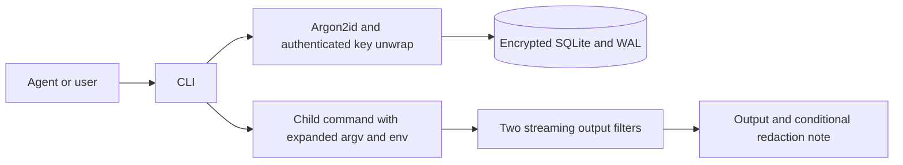

# Architecture and concurrency

AG-Secret is a short-lived Go/Cobra CLI. Each invocation unlocks one local SQLite
vault. Commands receiving secrets hold plaintext in memory only as long as
needed; pass disclosure requires an explicit option or an allowed output path.
The CLI never renders a TOTP seed: default view uses `[set]`, even with a
revealing mask, and the disclosure option only shows the current code. A name
maps to a random ID that remains stable while its secret and type are unchanged;
changing either creates a new ID and immediately invalidates the previous ID.

## SQLite driver choice

| Consideration | Selected: ncruces SQLite + Adiantum, no CGO | C SQLite / SQLCipher via CGO |
| --- | --- | --- |
| Developer setup | Go toolchain, no C compiler or native SQLite library | C compiler, native headers/libraries or bundled C sources |
| Cross compilation | `CGO_ENABLED=0 GOOS=... GOARCH=... go build` | Per-target C toolchain and native library configuration |
| SQLite transactions | WAL, locks, immediate transactions, busy timeout | Same SQLite primitives, mature native VFS |
| Encryption | Adiantum VFS, deterministic encrypted disk blocks | SQLCipher can authenticate encrypted pages using HMAC |
| Portability | Driver supports Linux/macOS/Windows; device integration needs OS code | Build and distribution depend on target native toolchains |
| Main tradeoff | Go VFS is younger; storage encryption is not tamper authentication | More build and packaging complexity; useful when SQLCipher format/authentication is required |

This workload consists of small local records and short CLI operations. It does
not require CGO to support concurrent writers. We retain one driver and one
format rather than maintaining optional incompatible backends. Benchmark a
real workload before choosing a different driver for throughput. Switching to
SQLCipher would require an explicit data migration and additional distribution
work; no performance or tamper-resistance equivalence is claimed.

The selected VFS uses OFD locks on Linux/macOS and LockFileEx on Windows, plus
shared memory for WAL. Concurrent access must use compatible VFS locking; do
not mix alternate `sqlite3_flock`/`sqlite3_dotlk` builds on the same database.
Use a local filesystem with working SQLite locks and shared memory. Network
filesystems are not a deployment target for this WAL vault.

## Transactions

Each process uses `database/sql` with one open connection, a 5 second busy
timeout and `synchronous=FULL`. Connections use immediate write transactions:

- Put reads the prior record, preserves omitted policies, validates the final
  type/seed, and changes the ID and clears leak history atomically when the
  secret or type changes. Submitting the same secret and type, including
  policy-only updates, retains both the ID and leak history. A duplicate pass
  value produces a warning identifying the other matching IDs without plaintext;
  the check includes expired and disabled records.
- Report resolves a name/ID to its pass value, or takes exact pass plaintext from
  stdin, then appends the event to every matching pass record in one transaction.
  Expired and disabled records are included; TOTP records are excluded. Reports
  never change access policy. The JSON result is always an array of affected
  records and their full leak histories, including for a single match.
- Lecture checks and records `lecture_shown_at` together, so concurrent callers
  do not all print the 12-hour reminder.
- Reads return a consistent SQLite snapshot. Exec closes the database before
  launching a child and uses the collected records for that execution.

Concurrent operations have a serial order. A report before rotation is cleared
by that rotation for the rotated record. A report using an old ID after rotation
fails as not found: there is no historical ID alias, generation counter, or
fingerprint history. An Agent must not retry that report by name, which would
attribute the old exposure to the new value. Name and plaintext reports match
values present inside their transaction. All matching records receive the event
or none do. Reporting has no revoke option; people decide policy changes. A
policy decision cannot retract an already disclosed value or stop a running
command.

IDs contain 64 random bits; creation checks uniqueness while holding the write
transaction, with a UNIQUE database constraint as the final guard. IDs identify
the current value associated with a record and are not authentication capabilities.
Clients must refresh stored references after a secret or type change.

## Formats and upgrades

Schema 2 has `secrets` with ID, type, secret, mask, timestamps, policies and a
JSON `leaks` array, plus `meta_state`. Each leak has `reported_at`, `reason`,
`context`, `attachments`. Attachments are path references, not imported files.
Leak histories have no application-imposed count/size cap or automatic truncation;
rotation clears the history for that record.
Version 1 migration is transactional, assigns IDs and preserves data/policies.
Legacy static `otp` becomes `pass`; a code is not a TOTP seed. A legacy name
starting with the newly reserved `ags_` prefix remains accessible by its assigned
ID. Unknown schema versions fail without rewriting them.

New `.unlock` descriptors use version 2: Argon2id time=1, memory=16 MiB,
parallelism=2; XChaCha20-Poly1305 authenticates the wrapped random database key.
Version 1 descriptors retain time=3, memory=64 MiB, parallelism=4 to preserve
access to old databases. Initialization uses exclusive file creation and never
changes permissions on an existing parent directory.

Adiantum encrypts database data, rollback/WAL journals and temporary data files.
It does not authenticate every database page and reveals which blocks change
between snapshots. `.unlock` authentication does not make the entire database
tamper-proof. Protect the vault, pass file and backups with filesystem access
controls. The pass file can decrypt the database, so same-UID access remains a
trust boundary. Policy flags and reserving permission changes for people are
workflow rules, not an enforced distinction between human and Agent identities.
Keeping TOTP seeds out of CLI output does not protect them from same-UID code
with database or process-memory access. On Windows, use an appropriate private
directory ACL; Unix permission-bit checks are not an ACL audit.

## Execution and input boundaries

Token expansion is a single pass over argv and environment values; plaintext
containing another ID is not expanded recursively. An exec snapshots all records
once and computes one current TOTP value per used credential. Unknown, expired
or disabled tokens fail before child launch. Passing an ID inside shell source
explicitly allows the shell to parse the substituted secret; positional
arguments/environment values avoid that injection surface.

Each output stream has its own filter and retains only a suffix that could still
complete a secret (at most the longest pattern minus one byte). Nonmatching short
prompts are forwarded immediately so a child can wait for input without hiding
its prompt. A match becomes `[REDACTED:<id>]`; a finite fallback handles the
rare case where the marker itself contains a secret, ending with deletion if
necessary. No retry loop grows a marker indefinitely. Filters protect all active
passwords with at least four bytes, original/canonical TOTP seeds, and actual
injected values. Short passwords not injected by this invocation are not globally
filtered. If the same bytes belong to multiple records, one ID from the snapshot
labels the replacement. For a pass ID, reporting resolves its value and reports
every current matching pass record, so the label need not enumerate duplicates.
TOTP IDs are not reportable. The label is not proof of which record was exposed,
and old IDs cannot be resolved after rotation. Footer text is appended only after
draining and flushing both streams.
Exact matching cannot protect encodings, arbitrary transformations, cross-stream
splits, files, sockets, or direct TTY writes. Exec bounds waiting for inherited
pipes after direct-child exit with WaitDelay; it is not a process sandbox.

Get's Linux check finds the nearest command shell, parsing `/proc/PID/stat` after
the final `)` to avoid spaces/parentheses in comm. It compares pipe output identity
against that shell's fd 1 and fd 2. Only a distinct pipe is considered indirect:
regular-file redirects are ambiguous because a shell child can inherit a redirected
fd while its parent keeps the original fd, so they fail closed. A consumer can
still print command-substitution output again; this is an output-routing heuristic,
not information-flow tracking.
Other platforms permit terminal output or require the explicit override for
passwords. TOTP get outputs the short-lived code directly as specified.

Send rejects password control characters before invoking tmux: literal send mode
does not prevent a terminal from interpreting newlines or interrupt keys. It
inspects the target tmux TTY with `O_NOCTTY`, rejects ECHO unless overridden,
then sends literal text and optionally Enter. Echo state and pane identity can
change between inspection and injection; the receiver is trusted. No real user
pane is contacted during tests: unit tests use a private PTY and fake tmux
executable; `make integration` uses a separate real tmux server and temporary
socket when tmux is installed.

## Resource-bounded verification

`make test` and `make check` use `scripts/bounded-check.sh`. With a Linux user
systemd manager, a transient cgroup limits the full process tree to 2 GiB RAM,
zero swap, 256 tasks and 180 seconds. Without it, Linux uses a 2 GiB per-process
virtual-memory cap. Compilation uses `-p 1`; tests have a 2 minute timeout and
Go's GC memory target defaults to 512 MiB. `GOMEMLIMIT` alone is not a hard limit.

Tests cover RFC vectors, migrations, atomic policy preservation and leak reports,
process-level SQLite concurrency, pipe identity, real shell capture/substitution,
private PTY echo flags and exact tmux arguments, streaming chunk boundaries and
marker collisions. Builds on other target platforms verify compilation, not
runtime device integration there.
