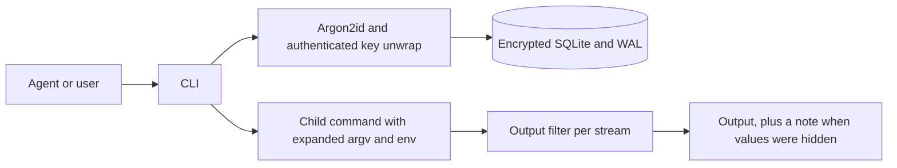

# Architecture

AG-Secret is a Go CLI built with Cobra. Each run opens one local SQLite vault,
does its work and exits. Secret values stay in memory only as long as a
command needs them. `get` prints a password only with an explicit
`--dangerously-skip-check`; the CLI never prints a TOTP seed, only its current
code.

Each secret has a name and a random ID. The ID stays the same while the value
and type stay the same. Changing either one assigns a new ID, and the old ID
stops working at once.

## SQLite driver

| | Chosen: ncruces SQLite + Adiantum, no CGO | Alternative: SQLCipher via CGO |
| --- | --- | --- |
| Setup | Go toolchain only | C compiler and native libraries |
| Cross-compiling | `CGO_ENABLED=0 GOOS=... GOARCH=... go build` | A C toolchain per target |
| Transactions | WAL, locks, immediate transactions, busy timeout | The same SQLite features, with a more mature native VFS |
| Encryption | Adiantum VFS; deterministic encrypted blocks | Can authenticate pages with HMAC |
| Main drawback | Younger VFS; encryption does not detect tampering | More build and packaging work |

The vault holds a few small secrets and every operation is short, so a native
driver would not be noticeably faster. We support one driver and one file
format rather than several incompatible backends.

The VFS uses OFD locks on Linux and macOS, LockFileEx on Windows, and shared
memory for the WAL. Every process that opens the vault must use the same
locking, so do not mix in builds that use `sqlite3_flock` or `sqlite3_dotlk`.
Keep the vault on a local filesystem; network filesystems are not supported.

## Transactions

Each process opens one connection with a 5-second busy timeout and
`synchronous=FULL`. Writes use immediate transactions, and commands that only
read never write.

- **put** reads the existing secret and applies only the changes it was given,
  so two people changing different options at once do not undo each other. If
  the value or type changed, it assigns a new ID and clears the leak reports in
  the same transaction. If the same password is stored under other names,
  including expired or disabled ones, put prints a note naming them.
- **report** looks up the password for an ID and adds the report to every
  password with that value, in a single transaction. Expired and disabled
  secrets are included; TOTP secrets are not. Reports never change access.
- **exec** reads all secrets at once, closes the vault, and then starts the
  command.

Concurrent commands are applied in some serial order. If a secret is replaced
after a report, the replacement clears that report. A report that uses an old
ID fails as not found, because old IDs are not kept. report never accepts a
name, so a delayed report cannot land on a newer value; the error tells the
agent that a replaced value needs no report.

IDs are 64 random bits. New IDs are checked for uniqueness inside the write
transaction, and a UNIQUE constraint backs that up. An ID names the current
value of a secret; it is not a password or capability.

## File formats

The database has a single `secrets` table: name, ID, type (`password` or
`totp`), value, timestamps in whole seconds, the two access options, and the
leak reports as a JSON array of `reported_at` and `reason`. `PRAGMA
user_version` records the format version, and agsecret refuses versions it does
not know without changing them.

The `.unlock` file holds the random database key, encrypted with
XChaCha20-Poly1305 under a key derived from the passphrase with Argon2id (time
1, 16 MiB of memory, parallelism 2). `init` creates every file exclusively: it
never replaces an existing vault or pass file, and it never changes the
permissions of an existing directory.

Adiantum encrypts the database, its journals and its temporary files. It does
not authenticate pages, and an observer can see which blocks change between
copies. The `.unlock` file is authenticated, but that does not make the whole
database tamper-proof. Protect the vault, the pass file and any backups with
file permissions. Anyone who can read the pass file can decrypt the vault, so
programs running as the same user are trusted.

Access options are a convention for agents, as is the rule that only people
change them and use `--dangerously` options: AG-Secret cannot tell a person
from an agent running as the same user. Hiding TOTP seeds from the CLI's output
likewise does not protect them from code that can read the database or process
memory. On Windows, use a private directory; the Unix permission checks do not
audit ACLs.

## exec

exec replaces IDs in the command's arguments and environment in a single pass,
so an ID that appears inside a secret's value is never expanded. Text that
looks like a mistyped ID (`ags_` plus eight or more hex digits in any case that
do not form a valid ID) is an error rather than being passed through as literal
text. IDs are also refused in the command name, and in the options and first
operand of a shell (the `-c` code or a script path), because the shell would
parse the value as code. The shell can follow wrappers such as `env`, `timeout`
or `sudo`. Other arguments and environment variables carry the value as data.
Unknown, expired and disabled IDs fail before the command starts, with exit
status 125. When nothing is filled in, exec says so, which catches a name used
where an ID belongs.

Standard output and standard error each get their own filter. A filter holds
back only the bytes that could still turn into a stored value, at most one byte
less than the longest value, so a short prompt such as `Password:` appears at
once. Rules are indexed by their first byte, so throughput does not fall with
the number of secrets. A match becomes `[REDACTED:<id>]`. If a secret's value
itself contains that marker, the filter falls back to shorter markers and
finally to removing the match entirely. The filters cover every unexpired
password of at least four bytes, every unexpired TOTP seed as stored and in
canonical Base32, and every value this run injected. When several secrets share
a value, one ID labels the match, and reporting that ID reaches all of them.
After both streams finish, a note on standard error lists the hidden IDs; the
note passes through the filter too. Exact matching cannot catch encoded or
transformed copies, a value split across the two streams, files, network
traffic or output written straight to the terminal.

exec forwards SIGTERM and SIGHUP to the command. It forwards SIGINT only when
standard input is not a terminal, because a terminal already sends Ctrl-C to
the whole foreground process group. The exit status is the command's own, or
128+N if signal N killed it. After the command exits, exec waits at most two
seconds for grandchildren still holding its output pipes. exec is not a
sandbox.

## get and send

`get` never prints a password unless given `--dangerously-skip-check`. Checking
whether standard output is a terminal would not protect agents that run
commands in a pseudo-terminal, and inspecting the process tree cannot follow
commands started through tmux or screen servers, so the explicit flag is the
only switch. TOTP codes are short-lived and are printed without it.

`send` refuses passwords with control characters before it runs tmux, because
tmux's literal mode does not stop the terminal from acting on newlines or
Ctrl-C. It confirms the pane exists with `send-keys -t` (`display-message`
falls back to the current pane), then opens the pane's terminal with
`O_NOCTTY` and checks that echo is off and canonical (line) input is on. That
is the mode password prompts from sudo, ssh, psql and getpass use. Shells and
REPLs turn echo off too, but they read raw keys and echo them themselves, so
they fail the check. The terminal mode or the pane could still change between
the check and the typing, and the program reading the password is trusted.

Tests never touch a real tmux session. Unit tests use a private pseudo-terminal
and a fake tmux; `make integration` starts a separate tmux server on a
temporary socket when tmux is installed.

## Testing

`make test` and `make check` run through `scripts/bounded-check.sh`, which
limits memory, CPU and run time. The tests cover the RFC 6238 vectors, option
changes and leak reports under concurrency (including separate processes),
terminal modes on a private pseudo-terminal, the exact tmux arguments, chunk
boundaries in the output filter and marker collisions. Cross-compiled builds
for other platforms only show that the code compiles there.
