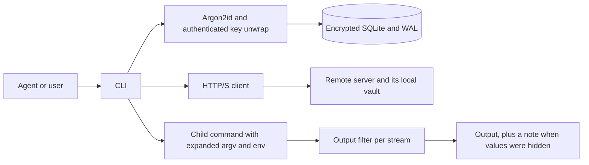

# Architecture

AG-Secret is a Go CLI built with Cobra. Commands open a local SQLite vault;
`serve` keeps it open while handling API requests. Client commands can also
resolve fields from mounted servers. Values remain in memory for the operation.
Passwords go through `exec` or `send` by default, and TOTP seeds stay at their
owning source. Receiving programs are trusted with the values they receive.

Each field has a name and a random ID. The ID stays the same while the value
and type stay the same. Changing either one assigns a new ID, and the old ID
stops working at once.

## Credentials and plain fields

A name is standalone or CREDENTIAL:FIELD, with exactly one colon separating
nonempty names. Credentials are derived namespaces, not separate records:
the first field creates a group and removing the last one removes the group.
Fields have no reserved names. Each field belongs to one group at most; equal
passwords still have independent IDs and the existing duplicate/report behavior.

rename changes a field's name and updated_at only. Group rename updates all
matching names in one transaction, rejecting existing target namespaces and
overlong names before writing. Group delete is one atomic DELETE. Matching uses
the exact colon boundary, not SQL wildcard patterns. IDs, counters, expiry,
access and history survive moves. Standalone names can equal credential names.

The plain type has visible values and no protection settings or use accounting.
Metadata reads select values only for plain, and JSON omits its inapplicable
policy fields. put rejects explicit protection settings on plain. Changing a
sensitive type to plain requires the value, creates a new ID, and clears the old
controls and history. Plain values are excluded from the redaction patterns,
including injected values, but a matching password pattern still takes effect.

ls orders standalone fields first, then namespaces and their fields lexically.
Its JSON is a flat record array in the same order; credential view wraps a
record array with the namespace name. Viewing a group never generates OTP
codes or consumes uses. Import and export are outside the current scope.

## SQLite driver

| | Chosen: ncruces SQLite + Adiantum, no CGO | Alternative: SQLCipher via CGO |
| --- | --- | --- |
| Setup | Go toolchain only | C compiler and native libraries |
| Cross-compiling | `CGO_ENABLED=0 GOOS=... GOARCH=... go build` | A C toolchain per target |
| Transactions | WAL, locks, immediate transactions, busy timeout | The same SQLite features, with a more mature native VFS |
| Encryption | Adiantum VFS; deterministic encrypted blocks | Can authenticate pages with HMAC |
| Main drawback | Younger VFS; encryption does not detect tampering | More build and packaging work |

The vault holds a few small secrets and every operation is short, so a native
driver would not be noticeably faster. We support one driver and one file
format rather than several incompatible backends.

The VFS uses OFD locks on Linux and macOS, LockFileEx on Windows, and shared
memory for the WAL. Every process that opens the vault must use the same
locking, so do not mix in builds that use `sqlite3_flock` or `sqlite3_dotlk`.
Keep the vault on a local filesystem; network filesystems are not supported.

## Transactions

Each process opens one connection with a 5-second busy timeout and
`synchronous=FULL`. Writes use immediate transactions, and commands that only
read never write.

- **put** reads the existing secret by name and applies only the changes it was given,
  so two people changing different options at once do not undo each other.
  Without the value, it refuses changes that widen access, extend the expiry or
  increase the use limit,
  unless given `--dangerously-skip-check`. If the value or type changed, it
  assigns a new ID and clears the leak reports in the same transaction. If the same password is stored under other names,
  including expired or disabled ones, put prints a note naming them.
- **report** looks up the password for an ID and adds the report to every
  password with that value, in a single transaction. Expired and disabled
  secrets are included; TOTP secrets are not. Reports never change access.
- **get/send/exec** validate the request or target and prepare the values.
  Immediately before handing them out, an immediate transaction rechecks all
  referenced IDs for expiry, access and remaining uses and increments each
  distinct sensitive ID's counter once. Plain fields are not counted. Any refusal rolls back the whole batch. IDs
  invalidated by a concurrent rotation are rejected. Downstream failures do not
  refund a committed authorization. Exec closes the local vault and network
  connections before child launch. The server also checks API key scope inside
  the transaction.

`--uses 0` means unlimited. Same-value updates retain the count, while a changed
value or type resets it with the new ID. Limits omitted from put stay unchanged.
Output redaction reads do not consume uses. These counters govern CLI
authorizations, not reuse of a value by a child process.

Concurrent commands are applied in some serial order. If a secret is replaced
after a report, the replacement clears that report. A report that uses an old
ID fails as not found, because old IDs are not kept. report never accepts a
name, so a delayed report cannot land on a newer value; the error tells the
agent that a replaced value needs no report.

IDs are 64 random bits. New IDs are checked for uniqueness inside the write
transaction, and a UNIQUE constraint backs that up. An ID names the current
value of a secret; it is not a password or capability.

## File formats

The `secrets` table holds name, ID, type (`password`,
`totp` or `plain`), value, timestamps in whole seconds, the two access options, and the
leak reports as a JSON array of `reported_at` and `reason`. Usage is stored in
`max_uses` (0 means unlimited) and `used_count`. The vault format is version 1.
Opening a vault validates `PRAGMA user_version` without rewriting it.

Management writes create two additional tables with `CREATE TABLE IF NOT EXISTS`:
`api_keys` stores names, SHA-256 token digests and ordered rules as JSON;
`remotes` stores mount names, URLs and API keys. Reads tolerate absent management
tables. New and existing vaults share these version 1 operations. Management
records share the vault's encryption and stay outside field listings and token
substitution.

The version 1 `.unlock` file holds the random database key, encrypted with
XChaCha20-Poly1305 under a key derived from the passphrase with Argon2id (time
1, 16 MiB of memory, parallelism 2). `init` creates every file exclusively: it
never replaces an existing vault or pass file, and it never changes the
permissions of an existing directory.

Adiantum encrypts the database, its journals and its temporary files. It does
not authenticate pages, and an observer can see which blocks change between
copies. The `.unlock` file is authenticated, but that does not make the whole
database tamper-proof. Protect the vault, the pass file and any backups with
file permissions. Anyone who can read the pass file can decrypt the vault, so
programs running as the same user are trusted.

Requiring the value to loosen limits discourages accidental renewals or access
changes. `--dangerously` options bypass such checks and are meant for people only;
AG-Secret cannot tell a person from an agent running as the same user. Hiding TOTP seeds from the CLI's output
likewise does not protect them from code that can read the database or process
memory. On Windows, use a private directory; the Unix permission checks do not
audit ACLs.

## Servers and sources

`internal/remote` provides a small standard-library HTTP/JSON protocol:

| Request | Operation |
| --- | --- |
| `GET /v1/fields` | List authorized field metadata and plain values |
| `GET /v1/field?ref=NAME_OR_ID` | Resolve one authorized field |
| `POST /v1/use` | Authorize a batch of IDs and return their values |
| `POST /v1/report` | Record a password leak and return authorized matches |

Every request uses a Bearer API key. Keys contain 32 random bytes; creation
returns the token once, and the server stores only its SHA-256 digest. Deleting
a key prevents subsequent authorizations. The service exposes its local vault
and never forwards requests to mounts. Management remains local.

Rules match complete names using `*`, `?` and `[]`, including across `:` and `/`.
They are case-sensitive, start denied, and apply in order: ordinary rules allow,
`!` rules exclude, and the last match wins. ID requests check the record's
current name. New fields, renames and rotations therefore follow the same
dynamic rules. Reports mark every matching password in the owning vault, while
responses reveal only records within the key's scope.

The client resolves names locally first, then by lexical mount name, merging
individual fields. Expired, disabled or exhausted fields retain precedence.
Metadata carries a source, which pins subsequent use to that source and ID.
Direct ID requests can find records hidden by a same-name field. Name lookups
stop at an unavailable higher-priority source; ID lookups may continue for an
exact match. An unresolved ID with unavailable sources produces an incomplete
lookup error. Full listings require every source to respond.

The owning source atomically checks permissions, expiry and counts for each
batch. The server returns passwords and plain values, and computes current
TOTP codes without sending seeds. Cross-source requests commit independently:
if a later source fails, earlier uses remain consumed and the child never
starts. Mutation requests have no automatic retries. A lost response may leave
a use consumed or a report recorded. Remote values have no persistent cache.

The default listener is HTTP on `127.0.0.1:8765`. Other interfaces support HTTP
for encrypted private networks, or HTTPS with a certificate and private key.
Clients verify HTTPS certificates, bypass environment proxies for HTTP, and
refuse redirects. TLS requires version 1.2 or newer. The
server uses bounded headers and request bodies (16 KiB and 1 MiB), header/read/
write/idle timeouts (5/15/30/60 seconds), and a five-second graceful shutdown.
Clients have a ten-second request timeout and a 64 MiB response limit; idle
connections close when the command finishes. API errors use fixed codes to
keep credential values out of diagnostics. API key holders can obtain passwords
within scope; client-side execution and redaction remain their responsibility.

## exec

`exec -c SCRIPT` selects /bin/sh (cmd.exe on Windows). It rejects IDs in SCRIPT
before reading the vault or consuming uses. The recommended workflow keeps the
script fixed and supplies IDs through environment values, with quoted variable
expansions in POSIX shells. Scripts can still execute values via eval or nested
interpreters; this is not a sandbox or a universal code/data guarantee.

`exec -- COMMAND [ARG...]` runs separate arguments directly. Quoted arguments
are never automatically split. exec replaces IDs in arguments and environment in a single pass,
so an ID that appears inside a secret's value is never expanded. Text that
looks like a mistyped ID (`ags_` plus eight or more hex digits in any case that
do not form a valid ID) is an error rather than being passed through as literal
text. IDs are refused in the executable name. All other direct-mode arguments
are substituted without interpreter, option or wrapper detection. In particular,
`exec -- bash -c 'echo ID'` substitutes a value into shell code and can cause
command injection. Callers own that boundary; output redaction cannot prevent
execution or side effects. Direct tmux/screen commands also receive normal
argument substitution; send provides the separate target and prompt checks.
Unknown, expired and disabled IDs fail before the command starts, with exit
status 125. When nothing is filled in, exec says so, which catches a name used
where an ID belongs.

Standard output and standard error each get their own filter. A filter holds
back only the bytes that could still turn into a stored value, at most one byte
less than the longest value, so a short prompt such as `Password:` appears at
once. Rules are indexed by their first byte, so throughput does not fall with
the number of secrets. A match becomes `[REDACTED:<id>]`. If a secret's value
itself contains that marker, the filter falls back to shorter markers and
finally to removing the match entirely. The filters cover every unexpired
local password of at least four bytes, every unexpired local TOTP seed as stored
and in canonical Base32, and every password injected by this run, including
remote passwords. Other remote values are never fetched for redaction. Generated
TOTP codes and plain values are not added to the filter. A matching password
rule still takes precedence if those bytes coincide. When several secrets share
a value, one ID labels the match, and reporting that ID reaches all of them.
After both streams finish, a note on standard error lists the hidden IDs; the
note passes through the filter too. Exact matching cannot catch encoded or
transformed copies, a value split across the two streams, files or network
traffic.

The command never holds the terminal: it runs in a new session without a
controlling terminal, and its standard input is a pipe that exec fills from its
own. This matters when an agent runs commands in a pseudo-terminal, where
anything written to the terminal reaches the agent; password prompts from git,
ssh or sudo could otherwise show a URL with a filled-in token. Wait does not
wait for the input copy, because a read from a terminal can block until the
user types. exec relays SIGINT, SIGTERM and SIGHUP to the command's process
group.
The exit status is the command's own, or 128+N if signal N killed it. After the
command exits, exec waits at most two seconds for grandchildren still holding
its output pipes. exec is not a sandbox.

## get and send

`get` refuses passwords by default on all platforms and in all output contexts.
It prints plain values freely and TOTP codes subject to access, expiry and use limits. People may opt
into unfiltered plaintext with `--dangerously-skip-check`; agents use `exec` or
`send` instead. No process ancestry or shell detection is involved. A pipe or
TTY cannot establish where a consumer will forward the value, so automatic
output-context exceptions cannot reliably prevent accidental exposure.

`send` checks local values for control characters before it runs tmux, because
tmux's literal mode does not stop the terminal from acting on newlines or
Ctrl-C. It confirms the pane exists with `send-keys -t` (`display-message`
falls back to the current pane), then opens the pane's terminal with
`O_NOCTTY` and checks that echo is off and canonical (line) input is on. That
is the mode password prompts from sudo, ssh, psql and getpass use. Shells and
REPLs turn echo off too, but they read raw keys and echo them themselves, so
they fail the check. The terminal mode or the pane could still change between
the check and the typing, and the program reading the password is trusted.
Plain fields bypass the hidden-prompt check, but still reject terminal control
characters. tmux targets are passed literally and resolved to a pane ID before
typing. AGSECRET_TMUX_SOCKET adds `-S SOCKET` to every tmux invocation; absent
that override, tmux inherits TMUX/TMUX_TMPDIR normally.

Remote metadata and the target pane are checked before value retrieval. After
retrieval, sensitive remote sends recheck the prompt and all values are checked
for control characters. A rejection at that stage has already consumed its use.

Tests never touch a real tmux session. Unit tests use a private pseudo-terminal
and a fake tmux; `make integration` starts a separate tmux server on a
temporary socket when tmux is installed.

## Testing

`make test` and `make check` run through `scripts/bounded-check.sh`, which
limits memory, CPU and run time. The tests cover the RFC 6238 vectors, option
changes and leak reports under concurrency (including separate processes),
terminal modes on a private pseudo-terminal, the exact tmux arguments, chunk
boundaries in the output filter and marker collisions. Cross-compiled builds
for other platforms only show that the code compiles there.
